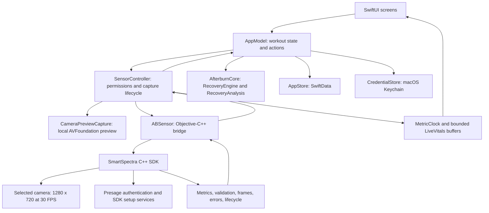

# Afterburn architecture and local development

This document describes the current implementation, its data flow, and the steps
needed to run a fresh checkout. The app is a native macOS SwiftUI application;
it does not require Electron, a web server, or a separate backend.

## 1. Product scope

Afterburn combines a camera stage, an exercise catalogue, workout planning, set
timing, live vitals, and a local recovery journal. Measurements come from the
SmartSpectra C++ SDK. There is no simulated pulse or demo measurement mode.

The recovery feature observes a measured pulse returning near a session
baseline. It does not measure calorie afterburn, muscle healing, or medical
readiness to exercise. `thoughts.md` preserves the original product idea;
the implemented observation rules below define the current behavior.

## 2. Platform and dependencies

| Component | Current choice |
| --- | --- |
| Hardware | Apple Silicon Mac; Intel macOS is unsupported by the SDK |
| Runtime | macOS 14 or later |
| UI | SwiftUI, AppKit integration, Swift Charts |
| Visual materials | Native Liquid Glass on macOS 26+, material fallback on earlier supported macOS |
| Observation | `@Observable`, main-actor app and sensor state, environment injection |
| Camera preview | AVFoundation, Core Image, in-memory `NSImage` frames |
| Measurement | SmartSpectra C++ SDK **3.5.0**, pinned in `scripts/setup.py` |
| Language bridge | Objective-C++ exposed through a Swift bridging header |
| Local persistence | SwiftData models containing Codable JSON payloads |
| Credential storage | macOS Keychain, or the development process environment |
| Project generation | CMake 3.26+ with the Xcode generator |
| Tests | A separate Swift Package containing the portable core |

Building the current source requires Xcode with a **macOS 26 or newer SDK**
because the source references Liquid Glass APIs. Runtime availability checks
preserve the macOS 14 deployment target. Use Python **3.12+** for the setup and
packaging scripts, including safe tar extraction support.

## 3. Component architecture



### App shell and UI

`AfterburnApp.swift` creates one window and owns the shared `AppModel`.
`RootView` switches between consent, Train, Exercises, Journal, and Settings.

The Train view uses a camera image as its background with floating controls,
session information, a timer, and a compact vitals panel. **All vitals** opens
the detailed measurement view with signal charts and SDK diagnostics. The
full-screen control uses the macOS window's actual full-screen mode.

The UI respects Reduce Motion and Reduce Transparency. Celebrations mark a
completed exercise set; they do not represent a health or safety assessment.

### Workout orchestration

`AppModel.swift` owns the exercise plan, selected movement and set, phase,
timers, baseline, recent pulse samples, and persistence actions. It coordinates
the sensor without embedding SDK calls in SwiftUI view bodies.

```mermaid
stateDiagram-v2
    [*] --> idle
    idle --> calibrating: Measure baseline
    calibrating --> idle: Cancel baseline
    calibrating --> ready: Baseline qualified
    ready --> working: Start set; stop camera
    working --> recovering: Finish set; start camera
    recovering --> result: Observed return or manual end
    result --> ready: Continue to next set
    result --> finished: Last set completed
    finished --> idle: New session
    calibrating --> interrupted: Capture interruption
    ready --> interrupted: Session interruption
    working --> interrupted: Session interruption
    recovering --> interrupted: Save interrupted observation
    interrupted --> calibrating: Fresh baseline
```



Timers use monotonic process uptime. Exercise set start and finish are manual.
Pausing pauses the exercise timer. Completing a baseline leaves measurement
running while the user is ready, allowing the longer HRV window to fill;
starting an exercise set stops the camera.

### Sensor lifecycle and camera ownership

`SensorController.swift` manages camera permission, selection, preview state,
SDK state, validation hints, typed measurements, and errors on the main actor.

There are two capture paths:

1. **Open camera** uses `CameraPreviewCapture` to check framing locally. It
   requires consent and camera permission, but does not require an API key or
   Apple Development signing. It produces no vital estimates.
2. **Measure baseline / Test SmartSpectra** stops that preview and starts the
   SDK's built-in camera source. The SDK supplies both measurement callbacks
   and the displayed preview.

The paths do not own the camera concurrently. Start and stop operations run on
serial worker queues; asynchronous completion waits for the prior camera owner
to release capture. Generation tokens and cancellation prevent old tasks from
restarting capture after a stop or consent withdrawal.

Preview delivery is bounded to one pending frame. The SDK receives the
configured **30 FPS** capture stream, while the preview copies every second
output frame. Skipping preview frames does not reduce the SDK's input rate.

### Native SDK bridge

`App/Bridge/AfterburnSensor.mm` configures and owns SmartSpectra. It:

- Preconfigures a persistent SDK cache under
  `~/Library/Application Support/Afterburn/SDK`.
- Requests the public breathing, cardio, and EDA bundles, matching the official
  macOS sample's physiological metric groups.
- Registers processing, validation, metrics, video, accepted/blocked-frame, and
  error callbacks before starting.
- Copies borrowed video buffers before returning from the callback.
- Converts protobuf measurements into typed `ABVital` objects.
- Dispatches public callbacks onto the main queue and suppresses callbacks from
  stopped generations.
- Disables SDK telemetry and accumulated output; does not configure recordings
  or register an LLM Insights callback.

Missing fields in one metric packet do not erase the last sample. Metrics can
arrive at different cadences. Unsupported or unauthorized signals are never
replaced with generated measurements.

### Portable measurement core

`Sources/AfterburnCore` contains no camera, SwiftUI, Keychain, or SDK dependency:

| Type | Responsibility |
| --- | --- |
| `RecoveryEngine` | Warm-up, valid baseline window, gap handling, sustained return near baseline |
| `RecoveryPolicy` | Explicit qualification parameters stored with observations |
| `RecoveryAnalysis` | Summaries of valid measured pulse and observed signal coverage |
| `MetricClock` | Maps SDK microsecond timestamps onto the monotonic app timeline while preserving sample age |
| `LiveVitals` | Keeps at most 600 points per vital, rejects replays and non-finite values, breaks charts across gaps |
| `Exercise`, `PlannedExercise`, `SetRecord` | Codable domain models |

### Live vitals and quality

| Display | SDK source | Initial window | Display confidence floor, when provided |
| --- | --- | --- | --- |
| Pulse | `cardio.pulse_rate` | 12 s | 40% |
| Breathing rate | `breathing.rate` | 30 s | 45% |
| HRV RMSSD, SDNN, mean NN, Baevsky index | `cardio.hrv` | 60 s | 50% |
| Relative arterial waveform | `cardio.arterial_pressure_trace` | 12 s | 40% |
| Chest and abdominal movement | `breathing.upper_trace`, `lower_trace` | 30 s | Stability flag; no independent confidence field |
| EDA Proxy | `eda.trace` | At least 35 s | Stability flag; no independent confidence field |

The current display also requires SDK validation OK, a stable sample, and a
timestamp no more than 3 seconds old or 0.5 seconds in the future. Sparse or
interrupted outputs can therefore show **Signal paused** even while the camera
is running. A missing signal stays blank, rather than becoming zero.

HRV timing statistics use milliseconds. The Baevsky index is unitless.
Arterial pressure and movement charts use relative units: the arterial waveform
is **not** a calibrated systolic or diastolic blood-pressure measurement.
EDA is a camera-derived proxy, not a contact skin-conductance sensor.

The five unavailable breathing metrics—amplitude, apnea, respiratory line
length, breathing baseline, and inhale/exhale ratio—are not requested. Face
expression analysis, micromotion, and experimental blood-pressure output are
outside the current app's measurement scope.

### Recovery qualification

Recovery uses a stricter policy than the general live display:

| Rule | Current value |
| --- | --- |
| Capture warm-up | 12 seconds |
| Baseline | 30 continuous seconds of valid pulse; median of samples |
| Confidence | At least 90% |
| Pulse range | 40–110 BPM, conservatively matching the documented range |
| Stability and validation | Stable sample and SDK validation OK |
| Maximum gap | 3 seconds; a larger gap resets qualification |
| Near-baseline tolerance | Absolute difference within 5 BPM |
| Confirmation | 15 continuous valid seconds after recovery warm-up |

For example, a live pulse with 70% SDK confidence can appear in the vitals view
while contributing nothing to baseline qualification. SDK confidence is a model
output, not a direct probability that the reading is medically accurate.

The observed recovery interval includes warm-up, confirmation, and gaps. It is
not an exact physiological baseline-crossing time. Manually ended and interrupted
observations retain those outcomes. No interpolation fills missing pulse data.

## 4. Storage, credentials, and network boundary

| Data | Location / handling |
| --- | --- |
| API key for development | Ignored `.env`, passed into the app's process environment by `scripts/run.py` |
| API key saved through Settings | macOS Keychain; service `app.afterburn.meter.smartspectra`, account `api-key` |
| Signing team preference | Ignored `.afterburn-local.json`; not a credential |
| Consent | Local UserDefaults, versioned notice; current version **2** |
| Workout plan and recovery observations | Local SwiftData, with encoded JSON payloads |
| Additional live vitals and waveforms | Bounded memory buffers; not added to the recovery journal |
| Raw camera frames | In-memory preview only; Afterburn does not save video or photos |
| SDK model/device cache | Per-user SDK cache outside the repository |
| Export | JSON chosen explicitly through the app's save dialog |

The SDK computes vitals locally. A working network connection is still required
for Presage authentication/subscription gating and SDK-related setup. Afterburn
does not implement a video upload service, cloud analysis backend, or offline
authentication bypass. The SDK is proprietary, so its complete network behavior
has not been independently audited by this project.

5G or a hotspot should not require lowering the camera rate to save upload
bandwidth. Preserve the SDK's 30 FPS input; optimize preview rendering and UI
work separately. Connectivity interruptions and startup service access still
need real network testing.

Consent is remembered per notice version. Withdrawal stops capture and returns
to onboarding without deleting saved history. Sleep and application termination
also stop capture. Legacy simulated records are excluded from history, export,
and analysis.

## 5. Local setup from a fresh checkout

### Prerequisites

1. Use an Apple Silicon Mac running macOS 14+.
2. Install Xcode with a macOS 26+ SDK. Open Xcode, accept its licence, and install
   any requested components. Ensure command-line tools point to that Xcode.
3. Install CMake 3.26+ and Python 3.12+. With Homebrew:

   ```sh
   brew install cmake python
   ```

4. Obtain your own SmartSpectra API key from the Presage developer portal.
5. For real measurements, sign into Xcode's Apple Accounts settings, select
   your team, and create an **Apple Development** certificate through
   **Manage Certificates → + → Apple Development**.

Check the selected tools:

```sh
xcode-select -p
xcodebuild -version
python3 --version
cmake --version
security find-identity -v -p codesigning
```

If a different Xcode is selected, choose the intended installation in
**Xcode → Settings → Locations → Command Line Tools**. Read the Team ID from
your Xcode account/team details. Do not substitute the certificate's personal
identifier for the Team ID.

### Configure the API key locally

From the repository root, create the local file without overwriting an existing
one:

```sh
cp -n .env.example .env
```

Edit `.env` in your editor and set `SMARTSPECTRA_API_KEY` to your personal key.
The committed `.env.example` contains only an empty variable. Do not put the
real key in source code, documentation, screenshots, terminal arguments, or Git.

Alternatively, use an already configured process environment or save the key
through the app's **Settings → Save to Keychain** action.

### Build and run a signed development app

Replace the placeholder with your own team identifier:

```sh
python3 scripts/build.py --team YOUR_TEAM_ID
python3 scripts/run.py
```

The build script invokes setup automatically. Setup downloads the official
pinned SDK into `.vendor/`, generates `build/live/Afterburn.xcodeproj`, and
creates the convenient root `Afterburn.xcodeproj` symlink. No Homebrew installation
of SmartSpectra is necessary for this repository's build path.

The team is remembered locally, so subsequent builds can use:

```sh
python3 scripts/build.py
python3 scripts/run.py
```

When macOS requests that `codesign` use the development certificate's private
key, authorize it locally. The password belongs to the relevant Keychain and
may differ from the current Mac login password after a migration or password
change. A certificate being visible does not prove its private key is usable.
Do not reset or delete a Keychain to work around signing.

The Debug app is generated at:

```text
build/live/Debug/Afterburn.app
```

`scripts/run.py` loads `.env` without shell evaluation and launches the Debug
binary. It does not print the key, put it in a command argument, or copy it into
the bundle. A local `.env` value overrides an inherited value of the same name.
`Open Afterburn.command` wraps this launcher for convenient local use.

Opening the `.app` directly through Finder or Xcode does not read `.env`; use
a previously saved Keychain credential or configure the Xcode process
environment locally. Do not commit credentials in a shared Xcode scheme.

### Run through Xcode

If you want to generate the project before building:

```sh
python3 scripts/setup.py --team YOUR_TEAM_ID
open Afterburn.xcodeproj
```

Select the **Afterburn** scheme, destination **My Mac**, and the app target.
Under **Signing & Capabilities**, select your team and keep automatic signing.
The project configures the camera entitlement, application/team identifiers,
Keychain access group, and hardened runtime. Press **Run**.

### Interface and camera testing without a usable signing key

```sh
python3 scripts/build.py --team YOUR_TEAM_ID --development
python3 scripts/run.py
```

This creates an ad-hoc signed build for interface and AVFoundation preview
testing. The script still expects a supplied or previously remembered team ID.
**Open camera** works independently of SDK startup. This is not a supported
SmartSpectra measurement configuration; real SDK measurements require the
Apple Development signed build and its Keychain entitlements.

### First live check

1. Review and accept the current consent notice. It is shown again only after
   withdrawal or a notice-version change.
2. Allow the macOS camera permission when requested.
3. Use **Open camera** to check framing, then **Measure baseline**; alternatively
   use **Settings → Test SmartSpectra**.
4. Keep the camera stationary and your face and upper chest visible, evenly lit,
   and still. Breathing/abdominal signals need the corresponding body region
   in view. Avoid talking during capture.
5. Open **All vitals** for the actual SDK validation hint, accepted/blocked frame
   counts, packet count, pulse sample count, charts, and quality labels.
6. Allow each measurement window to fill. Camera preview and `kRunning` alone
   are not proof that a valid pulse measurement has arrived.

## 6. Build and runtime packaging

`CMakeLists.txt` imports `SmartSpectra::SDK`, includes its provided dependencies,
and compiles Swift plus Objective-C++. `scripts/embed_runtime.py` packages:

```text
Afterburn.app/Contents/
  MacOS/Afterburn
  Resources/
    exercises.json
    SmartSpectraRuntime/
      libsmartspectra.dylib
      smartspectra_manifest.json
      smartspectra/               # FFmpeg libraries and notices
    smartspectra/graph/           # Processing graph and model assets
    SmartSpectra-Licences/
```

A bundle-relative manifest and runpaths locate the SDK assets. The bridge
sets a consistent bundle-local working directory before SDK startup. Every
embedded dylib is re-signed using the app's identity before Xcode signs the
outer app. Debug signing avoids a network timestamp request; release packaging
has separate requirements.

Verify a completed build:

```sh
codesign --verify --deep --strict --verbose=2 build/live/Debug/Afterburn.app
codesign -d --entitlements - build/live/Debug/Afterburn.app
```

The effective entitlements must include the camera permission, your team's
application identifier, and the matching Keychain access group. Do not replace
them with someone else's team or private key.

`python3 scripts/build.py --release` builds the Release configuration;
`scripts/run.py` remains a Debug launcher. Distribution to other Macs requires
the appropriate distribution identity, signed libraries, notarization, and a
review of SDK redistribution and credential provisioning. A local development
build is not a notarized release.

## 7. Tests and verification

Run the portable core tests without starting the camera or contacting Presage:

```sh
swift test --scratch-path build/core-tests
```

The current suite has 20 tests covering warm-up, baseline and recovery windows,
confidence/stability, gaps, replays, non-finite input, record round-trips,
measured analysis, bounded vitals history, and timestamp normalization.

Hardware checks are separate: signed app launch, camera permission, ownership
handoff, lifecycle/validation callbacks, and real pulse delivery have been
smoke-tested during development. This does not establish physiological accuracy
or verify that every metric will be available for every camera, scene, or key.

## 8. Troubleshooting

| Symptom | Check |
| --- | --- |
| No development team on a fresh clone | Pass `--team YOUR_TEAM_ID` on the first setup/build |
| Build waits on `codesign` | Complete the protected macOS private-key authorization prompt locally |
| `errSecInternalComponent` / signing timeout | Check the login Keychain and the valid certificate's associated private key |
| Signing says unavailable in the app | Run the Apple Development build rather than the ad-hoc build |
| API key not configured | Launch through `scripts/run.py`, or save a personal key through Settings |
| Camera permission denied | System Settings → Privacy & Security → Camera → Afterburn |
| Camera unavailable | Close other camera apps, check the selected device, refresh while stopped |
| Video appears but pulse is blank | Read SDK validation, accepted frames, packet/sample counts, warm-up, and timestamp/quality state |
| Chest/motion/lighting hint | Follow the SDK's displayed instruction and keep capture stable |
| Baseline stays at 30 seconds despite a number | The 90% recovery threshold is stricter than the live display; validation or gaps may also reset progress |
| HRV is missing | Allow at least 60 seconds, maintain signal quality, and check metric access for the key |
| Sparse metrics show Signal paused | Current freshness policy is 3 seconds; empty packets do not create new samples |
| SDK graph/model load error | Re-run setup and confirm the packaged graph/models and manifest paths |
| Keychain password rejected | Try the appropriate prior Keychain password; preserve existing Keychain data |

## 9. Repository contents and exclusions

Source, tests, scripts, this documentation, the blank `.env.example`, catalogue,
app icon, and licence notices are versioned. `.gitignore` excludes real environment
files, local team settings, certificates and private keys, provisioning files,
downloaded SDK binaries, generated Xcode projects, builds, logs, databases,
recordings, measurement exports, and developer caches.

The generated project is intentionally absent from Git: regenerate it with
`scripts/setup.py`. Apple credentials stay in Xcode/Keychain, and each developer
uses their own team and Presage key. The SDK is downloaded during setup rather
than redistributed in the source repository.

The catalogue includes metadata and English instructions for 1,324 exercises.
It carries its upstream MIT licence. Gym Visual media is not included because
it needs a separate licence. SmartSpectra's proprietary and FFmpeg notices are
preserved during app packaging; the application itself has no newly assigned
open-source licence.

## 10. Primary references

- [SmartSpectra macOS setup and signing](https://smartspectra.presagetech.com/docs/cpp/macos/)
- [Official macOS SwiftUI example](https://github.com/Presage-Security/SmartSpectra/tree/main/cpp/samples/macos_swiftui_example)
- [C++ metric configuration](https://smartspectra.presagetech.com/docs/cpp/metrics)
- [SDK payload schema](https://smartspectra.presagetech.com/docs/data-types/)
- [Measurement quality and frame-rate guidance](https://smartspectra.presagetech.com/docs/measurement-quality/)
- [Model cards and limitations](https://smartspectra.presagetech.com/docs/model-cards-and-limitations/)
- [Official using-smartspectra skill](https://github.com/Presage-Security/SmartSpectra/tree/main/.agents/skills/using-smartspectra)
- [Apple certificate management](https://help.apple.com/xcode/mac/current/en.lproj/dev154b28f09.html)
- [Apple Keychain password guidance](https://support.apple.com/en-gb/guide/keychain-access/kyca2429/mac)
- [Exercise catalogue](https://github.com/hasaneyldrm/exercises-dataset)

The optional SDK skill is installed in the developer's Codex skills directory,
not in the app or its runtime bundle.
